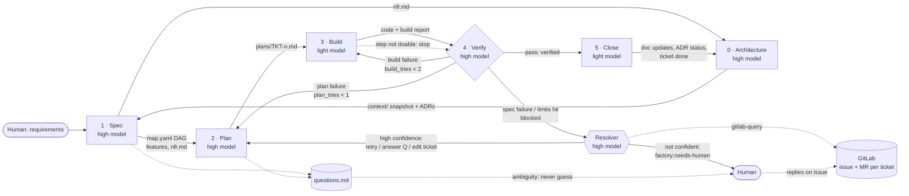
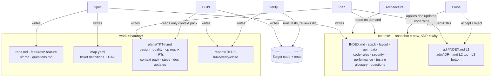
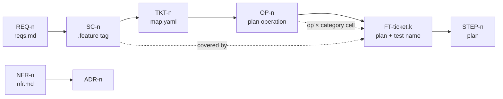
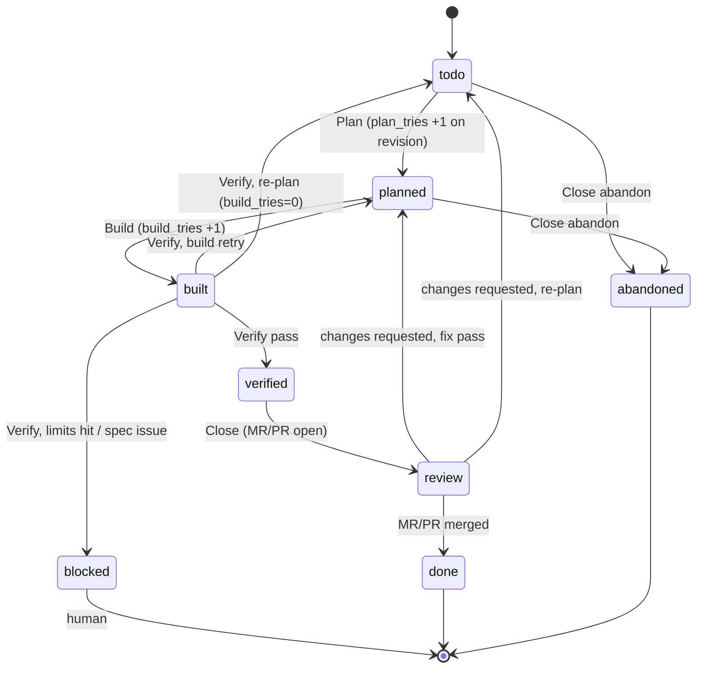
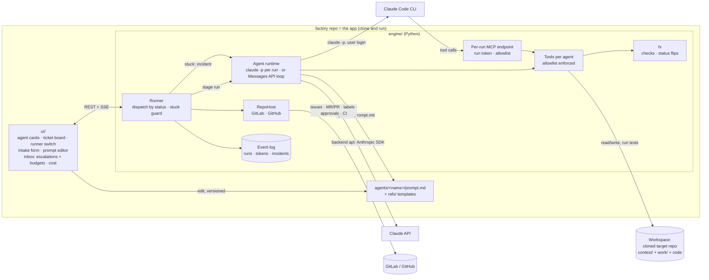

# Software Factory — Architecture

Diagrams of what this repo builds. Decisions and rules live in [DESIGN.md](DESIGN.md); this file only draws them.
Keep it in sync whenever stages, artifacts, scripts, or install layout change.

## 1. Pipeline and escalation

## 2. Artifacts: who writes, who reads

## 3. Traceability chain

`fx trace-check` fails on any uncovered scenario, empty matrix cell, or FT missing from code.

## 4. Ticket lifecycle

## 5. Runtime: standalone app (target design)

The agent context is built only from its prompt, the task and its tools: nothing from `~/.claude`.
